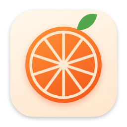
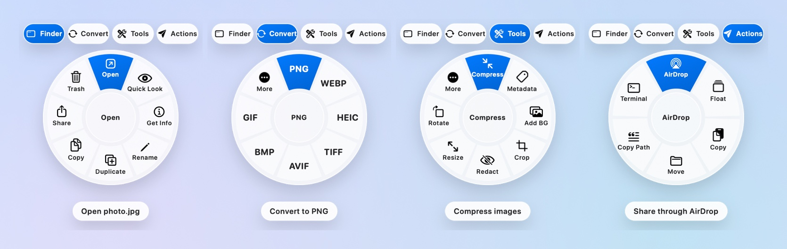
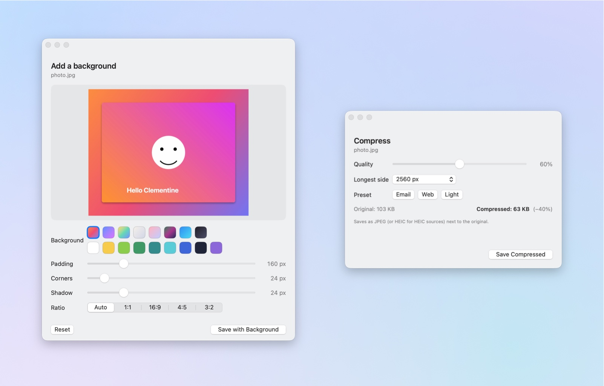
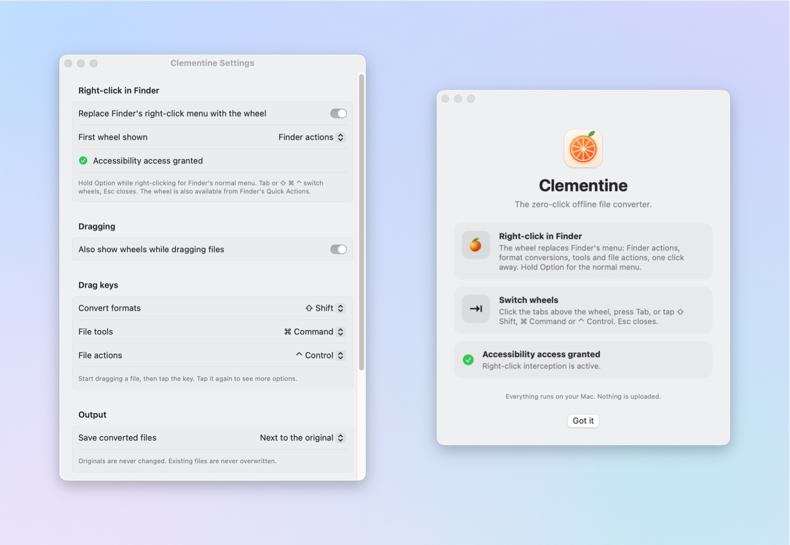

<p align="center">
  
</p>

<h1 align="center">Clementine — right-click file converter for the Mac Finder</h1>

<p align="center">
  <strong>Free, open-source macOS Finder extension.</strong> Right-click any file and a wheel appears: convert formats, compress, crop, add a background, redact, merge PDFs, AirDrop, and Finder's own actions, all in one click.<br>
  Everything runs on your Mac. Nothing is uploaded.
</p>

<p align="center">
  <a href="https://github.com/mushinskyy/clementine/releases/latest"></a>
  &nbsp;
  <a href="https://mushinskyy.github.io/clementine/"></a>
</p>

<p align="center">
  
  
  
  
</p>

<p align="center">
  
</p>

## What is Clementine?

Clementine is a free macOS menu bar app and Finder extension that replaces the right-click menu with a radial wheel. Instead of opening a separate converter app or uploading files to a website, you right-click a file in Finder, click a segment, and the result is saved next to the original. It converts images, video, audio, PDFs, documents, spreadsheets, subtitles and archives; compresses, crops, rotates and redacts; and gives you Finder's own commands (Open, Quick Look, Get Info, Rename, Duplicate, Share, Trash) on the same wheel. It works on Apple-silicon Macs running macOS 13 Ventura or later, and it never sends your files anywhere.

**Download:** [latest release](https://github.com/mushinskyy/clementine/releases/latest) · **Website:** [mushinskyy.github.io/clementine](https://mushinskyy.github.io/clementine/) · **License:** MIT

## Why people use it

- **One right-click.** No separate converter app, no drag-and-drop into a window, no website.
- **Offline and private.** Conversions use macOS frameworks plus a bundled ffmpeg. Your files stay on your disk.
- **Fast.** Hardware-accelerated image and video work through ImageIO and AVFoundation.
- **Finder-native.** The wheel carries Finder's own actions too, so you lose nothing by replacing the menu.
- **Safe.** Originals are never modified and existing files are never overwritten.
- **Open source.** Swift, no tracking, no accounts, builds with the Command Line Tools alone.

## The four wheels

Right-click a file in Finder and the wheel appears under the pointer. Switch faces with the tabs above it, the Tab key, or by tapping ⇧ ⌘ ⌃. Hold **Option** while right-clicking for Finder's normal menu. **Esc** closes.

| Wheel | What's on it |
|---|---|
| **Finder** | Open, Quick Look, Get Info, Rename, Duplicate, Copy, Share, Trash. On empty space: New Folder, Paste, Select All, View Options, Clean Up, Terminal. |
| **Convert** | Every format the selected files can become: images, video, audio, PDF, documents, spreadsheets, subtitles, archives. |
| **Tools** | Compress, Add Background, Crop, Redact, Metadata removal, Resize, Rotate, Mono, One PDF, Collage, Merge, Split, Trim, Mute, Thumbnail, GIF. |
| **Actions** | AirDrop, Float (a shelf you can drag files back out of), Copy, Move, Copy Path, Open in Terminal. |

## Supported formats

| Input | Output |
|---|---|
| Images: JPG, PNG, HEIC, TIFF, WebP, AVIF, BMP, GIF, SVG, PSD, RAW | PNG, JPG, WebP, HEIC, TIFF, AVIF, BMP, GIF, PDF |
| Video: MP4, MOV, MKV, WebM, AVI, WMV, MPEG, TS, 3GP | MP4, MOV, MKV, WebM, animated GIF; audio as M4A, MP3, WAV, AIFF, FLAC, OGG, Opus |
| Audio: MP3, M4A, WAV, FLAC, AIFF, OGG, Opus, WMA, CAF | M4A, MP3, WAV, AIFF, FLAC, CAF, OGG, Opus |
| PDF | PNG or JPG pages at 300 DPI, TXT, DOCX, RTF, HTML |
| Documents: DOCX, DOC, ODT, RTF, TXT, HTML, Markdown | PDF, DOCX, TXT, RTF, HTML, ODT, DOC, Markdown |
| Spreadsheets: CSV, TSV, XLSX | XLSX, CSV, TSV, JSON, HTML, Markdown |
| Subtitles: SRT, VTT | SRT, VTT, plain text |
| Archives: ZIP, TAR, GZ, BZ2, XZ | Extract; anything can be packed into ZIP, TAR or TAR.GZ |

Tools that need a decision open a small window first:

<p align="center">
  
</p>

- **Add Background** places an image on a gradient or color with padding, corner radius, shadow and aspect ratio. Handy for app screenshots and social posts.
- **Compress** shows the estimated file size while you move the quality slider, with Email, Web and Light presets.
- **Crop** takes an aspect ratio or exact pixel size.
- **Redact** finds faces (or text, when there are no faces) with Apple's Vision framework and covers them.

## Install on macOS

Requirements: an Apple-silicon Mac (M1 or later) running macOS 13 Ventura, 14 Sonoma, 15 Sequoia or 26.

### Download (no build tools needed)

1. Download `Clementine.zip` from the [latest release](https://github.com/mushinskyy/clementine/releases/latest) and unzip it.
2. Move `Clementine.app` to your Applications folder.
3. The app isn't notarized, so the first launch takes one extra step: right-click `Clementine.app`, choose **Open**, and confirm. (Or run `xattr -d com.apple.quarantine /Applications/Clementine.app` in Terminal.)
4. Grant the two permissions it asks for (see below).

### Build from source

You need the Xcode Command Line Tools (`xcode-select --install`); Xcode itself is not required.

```bash
git clone https://github.com/mushinskyy/clementine.git
cd clementine
./build.sh
```

The script compiles the app and its Finder extension, downloads a checksum-verified static ffmpeg into `Vendor/` on the first run, builds the icon, signs everything, installs to `/Applications`, registers the Finder extension and installs the Quick Actions. Set `CLEMENTINE_NO_FFMPEG=1` to build without ffmpeg (you lose MKV, WebM, MP3, OGG, Opus and WebP output).

### Permissions

Clementine asks for two things on first launch:

- **Accessibility** lets it intercept right-clicks in Finder and show the wheel. Without it, the wheel is still reachable from Finder's **Quick Actions** submenu and from the menu bar icon.
- **Automation (Finder)** lets the Finder wheel read the selection and perform Get Info, Rename, New Folder and Quick Look.

Both can be changed later in System Settings → Privacy & Security.

<p align="center">
  
</p>

## Frequently asked questions

**Is Clementine free?**
Yes. It's open source under the MIT license, with no accounts, subscriptions, ads or telemetry.

**Does it upload my files anywhere?**
No. Every conversion runs on your Mac using Apple's frameworks and a bundled copy of ffmpeg. It makes no network connections.

**How is this different from online file converters?**
Online converters need you to upload a copy of your file to someone else's server. Clementine does the same job locally, from the Finder right-click menu, with no size limits and no waiting for uploads.

**How is it different from Automator Quick Actions or Shortcuts?**
Those give you a text menu you have to build yourself. Clementine ships with hundreds of ready-made conversions and tools, picks the right ones for the selected file type, and shows them on a wheel under the pointer. It also installs Quick Actions, so both approaches work together.

**Which macOS versions and Macs are supported?**
Apple-silicon Macs (M1 and later) on macOS 13 Ventura or newer, including macOS 26. Intel Macs are not supported by the prebuilt release.

**Can I keep Finder's normal right-click menu?**
Yes. Hold Option while right-clicking, or turn off "Replace Finder's right-click menu" in Settings and use the Quick Actions instead.

**Does it change my original files?**
Never. Results are written as new files next to the original (or to Desktop or Downloads, if you prefer), and existing files are never overwritten.

**Why isn't it notarized?**
Notarization needs a paid Apple Developer account. The source is here for anyone to read and build; the release zip is the same build, signed locally.

## How it works

- A menu bar app watches right-clicks through a CoreGraphics event tap. When the click lands on a Finder window or the Desktop, the click is swallowed and the wheel is shown; the Dock, the menu bar and other apps are left alone.
- Conversions use ImageIO, AVFoundation, PDFKit, Vision and `textutil`/`afconvert`, with the bundled ffmpeg for formats macOS can't handle.
- A Finder Sync extension adds a Clementine submenu and toolbar button in folders that aren't managed by a File Provider (iCloud Drive's Desktop and Documents are, which is why the right-click takeover exists).
- Quick Actions in `~/Library/Services` give the same entry points from Finder's own menu.
- The wheel can also appear while **dragging** a file: tap ⇧, ⌘ or ⌃ mid-drag and drop the file on a segment. Off by default; lives in Settings.

## Uninstall

```bash
rm -rf /Applications/Clementine.app ~/Library/Services/Clementine*.workflow
```

Then remove Clementine from Accessibility and Automation in System Settings → Privacy & Security.

## Project layout

```
Sources/              the app (Swift, AppKit + SwiftUI)
FinderExt/            the Finder Sync extension
Assets/               icon generator and screenshot compositor
docs/                 website (GitHub Pages) and images
build.sh              build, sign, install, register
install-quick-actions.sh
make-screenshots.sh   regenerates the images in docs/
```

`build.sh` works around a stale module map in the Command Line Tools with a compiler VFS overlay; that's why it doesn't call `swiftc` directly.

## Credits and licenses

- Clementine is MIT licensed (see `LICENSE`).
- The bundled ffmpeg is a GPL static build by [Martin Riedl](https://ffmpeg.martin-riedl.de/); its license terms apply to that binary. It is downloaded at build time and not part of this repository.

---

<sub>Keywords, for the search engines: macOS Finder extension · right-click file converter · convert HEIC to JPG on Mac · convert MOV to MP4 · compress images on Mac · free offline file converter · Mac menu bar app · open source macOS utility · Finder context menu · PDF to PNG · WebM to MP4 · radial menu · pie menu for Finder.</sub>
